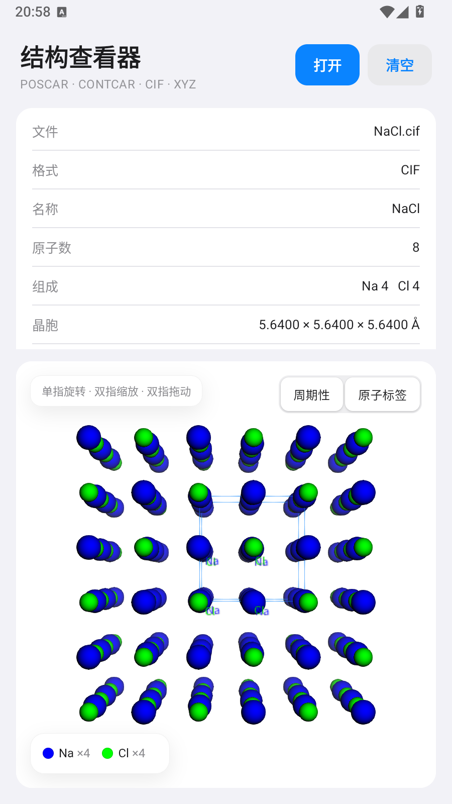

<div align="center">

# 结构查看器 · phone-view

**在 Android 手机上直接打开 POSCAR / CONTCAR / CIF / XYZ 结构文件，用 WebView + 3Dmol.js 做 3D 可视化。**

[](https://developer.android.com)
[](https://github.com/moyulyy/phone-view/releases/latest)
[](app/build.gradle)
[](https://kotlinlang.org)
[](https://3dmol.org)
[](LICENSE)



</div>

## 简介

计算材料 / 化学常用的结构文件（VASP 的 `POSCAR` / `CONTCAR`、晶体学 `CIF`、分子坐标 `XYZ`）
通常只能在电脑上用 VESTA、Ovito 等工具查看。**phone-view** 把这些格式搬到了手机上：

- 从文件管理器「打开方式」或任意应用的「分享」菜单**直接打开**结构文件，无需先导入；
- 原生页面展示结构摘要（原子数、元素组成、晶胞参数、体积），下方 WebView 里实时渲染 3D 模型；
- 纯本地运行、无网络、无第三方 SDK、无广告，安装包约 3 MB。

## 下载安装

- **推荐**：从 [Releases · v1.0](https://github.com/moyulyy/phone-view/releases/latest) 下载
  [`phone-view-1.0.apk`](https://github.com/moyulyy/phone-view/releases/latest/download/phone-view-1.0.apk)
  （`versionName 1.0`，使用 debug 签名，可直接侧载；适用 Android 7.0+）。
  手机浏览器下载后允许「安装未知应用」即可安装。
- 仓库内也保留了一份副本：[dist/phone-view-1.0.apk](dist/phone-view-1.0.apk)
  （SHA-256 `d22053359c52a115e3d9eaa6b2e5005a9b947ec1fb6e3f419778d3e6eb38a1e8`）。
- 或从源码自行构建，见 [构建](#构建)。

## 支持格式

| 格式 | 说明 | 处理方式 |
|------|------|----------|
| **POSCAR / CONTCAR** | VASP 结构文件（含 `.vasp`） | Kotlin 解析 → 生成标准 CIF → 3Dmol 显示 |
| **CIF** | 晶体学信息文件（`data_*`、晶胞参数、原子位点） | 原始内容直接交给 3Dmol（自动处理对称性/晶胞） |
| **XYZ** | 分子坐标文件（首行原子数） | 原始内容交给 3Dmol |

- 支持 Direct / Cartesian 坐标、无元素符号（仅原子数）的 POSCAR。
- 支持 CIF 数值不确定度写法 `5.640(2)`、分数坐标与笛卡尔坐标。
- 自动识别格式（优先扩展名，其次内容嗅探），因此无扩展名的 `POSCAR` / `CONTCAR` 也能识别。

## 功能特性

- **iOS 风格界面**：大标题 + 圆角胶囊按钮；信息为白色分组卡片（圆角 16dp、细分隔线），
  3D 视图为圆角卡片；视图内的提示、开关、图例使用毛玻璃（backdrop blur）浮层与 iOS 分段控件。
- **3D 可视化**：白色背景，球棍模型 + 晶胞棱边，单指旋转 · 双指缩放 · 双指拖动平移。
- **晶格显示**：绘制晶胞的 12 条棱边（构成 6 个面），iOS 蓝 (#0A84FF) 描边。
- **周期性边界条件**：默认复制相邻晶胞（3×3×3 居中；原子过多时自动降为 2×2×2），
  使跨边界的键与结构连续；右上角「周期性」开关可切换，无晶胞的分子结构自动隐藏该项。
- **元素颜色标签**：左下角毛玻璃图例显示每种元素的颜色球与数量（与 3Dmol 默认 Jmol 配色一致）；
  「原子标签」开关可在原子旁显示元素符号（仅标注原始晶胞，原子数 ≤ 120 时启用）。
- **结构摘要**：分组列表展示文件名、格式、名称、原子数、元素组成、晶胞参数 (a, b, c, α, β, γ)、体积；
  卡片高度限制在屏幕 30% 以内，不会挤压 3D 视图。
- **大文件友好**：解析在后台线程完成，结果通过 `evaluateJavascript` 注入 WebView；
  超胞复制按原子总数（≈15000）自动降级，避免手机卡顿。

## 与其它应用集成

安装后，在文件管理器中对 `.cif` / `.xyz` / `.vasp` / `POSCAR` / `CONTCAR` 文件选择
「打开方式」即可用本应用打开；也可在任意文件上「分享」到本应用。

已注册的入口：

| 入口 | 说明 |
|------|------|
| `ACTION_VIEW` + `file://` + 后缀 | 覆盖 `.cif` `.xyz` `.vasp` `.poscar` `.contcar`（含大小写与无后缀的 `POSCAR` / `CONTCAR`） |
| `ACTION_VIEW` + `content://` + MIME | `chemical/x-cif`、`chemical/x-xyz`、`application/x-cif`、`application/x-xyz`、`text/plain` |
| `ACTION_SEND` | 接收任意文件分享（`*/*`），对没有标准 MIME 的 POSCAR 最可靠 |

同时保留应用内「打开文件」按钮（系统文件选择器 `OpenDocument`）作为备用入口。
Android 12 及以下读取 `file://` 时按需申请 `READ_EXTERNAL_STORAGE` 权限。

## 构建

需要 **JDK 17** 与 **Android SDK**（compileSdk 36；`local.properties` 中配置 `sdk.dir`，
或将 `ANDROID_HOME` 指向 SDK 目录）。应用最低支持 Android 7.0（API 24）。

```bash
./gradlew assembleDebug      # 调试包
./gradlew assembleRelease    # 发布包（使用 debug 签名，可直接安装）
./gradlew testDebugUnitTest  # 运行解析器单元测试
```

产物：

- `app/build/outputs/apk/debug/app-debug.apk`
- `app/build/outputs/apk/release/app-release.apk`

> Windows 下使用 `gradlew.bat`；也可用系统已安装的 `gradle`（8.x）代替 wrapper。

## 目录结构

```
phone-view/
├── app/src/main/
│   ├── java/com/example/structureviewer/
│   │   ├── MainActivity.kt      # 界面、意图处理、格式识别、分组信息卡片
│   │   ├── Structure.kt         # Vec3 / Cell / Atom / Structure 数据模型
│   │   ├── Geometry.kt          # 晶格/分数坐标/矩阵求逆等几何运算
│   │   ├── Parsers.kt           # VASP / XYZ / CIF 解析器
│   │   └── CifExporter.kt       # 结构 → 标准 CIF 文本
│   ├── assets/
│   │   ├── 3Dmol-min.js         # 3D 可视化库（3Dmol.js，内置离线使用）
│   │   └── viewer.html          # WebView 页面：白底、晶胞棱边、周期性复制、颜色图例、iOS 毛玻璃浮层
│   ├── res/drawable/            # 卡片/按钮背景、自适应图标前景背景
│   ├── res/mipmap-anydpi*/      # 自适应图标 (API 26+) 与兼容图标
│   ├── res/values/              # iOS 系统色板、浅色主题、字符串
│   └── AndroidManifest.xml      # 意图过滤器与权限
├── app/src/test/                # JVM 单元测试（VASP / XYZ / CIF 解析）
├── samples/                     # 示例结构文件：POSCAR、test.xyz、NaCl.cif
├── docs/screenshot.png          # 界面截图
├── dist/phone-view-1.0.apk      # 预构建安装包
├── gradle/wrapper/              # Gradle Wrapper 8.14.3
└── build.gradle                 # AGP 8.9.2 + Kotlin 2.1.0
```

## 实现要点

1. **解析与渲染分离**：Kotlin 侧只负责格式识别、解析和摘要统计；VASP 结构先经 `CifExporter`
   转成标准 CIF，再和原始 CIF / XYZ 一样交给 3Dmol，因此三种格式共用同一套渲染逻辑。
2. **晶胞与周期性**：从 3Dmol 模型的 `getCrystData()` 取晶胞参数，按 3Dmol 的约定构造晶格矩阵
   绘制 12 条棱边；`replicateUnitCell(n, n, n)` 复制相邻晶胞，让跨边界的键在视觉上连续。
3. **零第三方依赖**：除 AndroidX / Kotlin 标准库外不引入任何库，3Dmol.js 以静态资源打包进 APK，
   完全离线可用。
4. **界面实现**：不依赖 Compose 或 Material 组件，用原生 View + shape drawable 手写 iOS 分组卡片风格。

## 已知限制

- 预构建 APK 使用 debug 签名，仅适合自用/侧载；上架或正式分发请配置自己的签名。
- 周期性显示最多 3×3×3 超胞，且按原子总数自动降级；原子标签仅在原始晶胞且原子数 ≤ 120 时显示。
- CIF 的对称性展开由 3Dmol 处理，极少数非标准写法可能显示不全。
- 暂不支持导出图片或测量键长/键角。

## 测试样例

`samples/` 目录下包含 `POSCAR`、`test.xyz`、`NaCl.cif` 三个示例文件，可直接用本应用打开。
解析器单元测试位于 `app/src/test/java/com/example/structureviewer/ParserTest.kt`：

```bash
./gradlew testDebugUnitTest
```

## 许可证

本项目基于 [MIT License](LICENSE) 开源。
3Dmol.js 由其各自许可证（BSD-3-Clause）授权。
